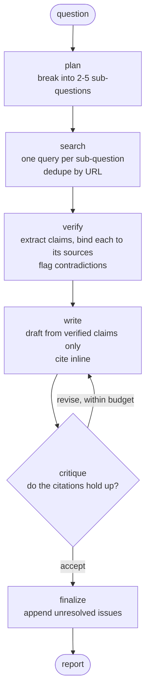

# Autonomous Research Agent

Ask it a research question. It breaks the question down, searches the web, checks
every claim against the source it came from, and writes a report where each
factual sentence carries a citation. A separate critic agent reviews the draft
and sends it back if the citations don't hold up.

Built with LangGraph, Tavily and Claude.

**The short version of the result: the critic doesn't help.** Details below.

---

## What it does

Most LLM research tools produce a confident report where some sentences come from
the sources and some come from the model's own knowledge, and you can't tell which
is which. This one tries to make that distinction enforceable.

The core idea is that a claim must name the source that supports it, and that rule
lives in the type system rather than in a prompt:

```python
class Claim(BaseModel):
    statement: str
    source_urls: list[str] = Field(min_length=1)
```

A claim with no source raises a `ValidationError`. It cannot be constructed. The
fact-checking step has nowhere to put an unsourced statement except a separate
`unsupported_claims` list, which the writer is told to leave out.

A model can ignore a prompt. It can't ignore a schema.

### Does that actually work?

Yes, and there's a clean test for it. Run the pipeline with the mock search
backend, which returns realistic-looking sources containing no real facts, and ask
it about model drift detection — something Claude knows plenty about from training.

A normal RAG pipeline writes a fluent, confident report from memory and attaches
citations that don't support it. This one extracted **0 claims**, put 4 statements
in `unsupported_claims`, and wrote a report saying it couldn't report any findings.

---

## Architecture



| Node | What it does | Returns |
|---|---|---|
| `plan` | Splits the question into 2–5 sub-questions with keyword search queries | `Plan` |
| `search` | Queries each sub-question, deduplicates by URL, caps the total | `list[Source]` |
| `verify` | Pulls out claims, each bound to the source URLs supporting it. Flags contradictions and unsupported statements | `Verification` |
| `write` | Writes the report using only verified claims, citing inline as `[n]` | Markdown |
| `critique` | Checks the draft against the verification notes. Accepts, or returns specific issues | `Review` |
| `finalize` | If the loop never converged, releases the best-rated draft with the open issues appended | Markdown |

LangGraph rather than a plain chain because the `write → critique → write` loop is
a cycle, and chains can't loop.

The revision budget is bounded by `MAX_REVISIONS`. If it runs out while the critic
is still unhappy, the report ships with an **Unresolved Review Issues** section
rather than pretending to be clean.

---

## Results

I ran an ablation: same questions, same retrieval, critic on versus critic off.

**Sourced claim rate** is the metric — of every factual sentence in the report,
what fraction is correctly cited. It penalises both wrong citations and missing
ones, so you can't game it by just not citing things.

Six questions. Retrieval is computed once per question and both arms get the
identical source list, so the critic is the only thing that differs.

| | control | placebo | critic |
|---|---|---|---|
| sourced claim rate | 91.4% | 91.4% | **90.2%** |
| citation coverage | 98.7% | 98.7% | 98.7% |
| drafts per report | 1.00 | 1.00 | 1.33 |

**Net effect: −1.2 points.** Noise floor: 0.0 points.

The critic intervened on 1 question out of 6. On the other 5 it accepted the first
draft, so the two arms were identical and measured identical — exactly 0.0%
difference each time.

Full results, including per-sentence judgments: [`evals/results/`](evals/results/).

### Why it's zero

The first draft is already good. By the time I'd finished fixing the evaluation,
the writer and verification layer together were producing reports at 91.4% sourced
claims and 98.7% citation coverage. There was nothing left for the critic to catch.

Tracking the control baseline across runs as I fixed measurement bugs: 76.5% →
82.6% → 91.9% → 91.4%. Every fix improved the **first draft**. The critic had been
compensating for defects in the writer prompt, and those are better fixed in the
writer prompt.

### So is the critic useless?

It catches real defects. There's a test (`tests/test_critic.py`) that feeds it a
report with four planted errors — a claim from the "unsupported" list used as fact,
an uncited assertion, a dropped contradiction, and a citation pointing at the wrong
source index. It finds all four and names them specifically. There's a second test
with a clean report, because a critic that rejects everything would pass the first
test and be just as useless.

So it works. It just has nothing to do on clean input. It's insurance against the
occasional bad draft, not an average improvement, and it costs 33% more drafts.

### The one time it intervened, it made things worse

On q01 the critic ran three drafts, raised issues every time, and never accepted.
The report lost **31.5 points**.

The cause: the system was shipping the *last* draft of that chain. A revision chain
the critic keeps rejecting is the writer thrashing, not improving. I changed
`finalize` to release the draft the critic rated best — using the critic's own
issue counts, which the agent has at runtime, not the evaluation's score. That
moved q01 from −31.5 to −7.1 and the aggregate from −5.2% to −1.2%.

That was the single most useful change in the project.

---

## The evaluation was broken four times before it worked

This is the part I'd actually want to talk about.

**1. The metric rewarded not citing.** My first metric was supported citations
divided by cited sentences. A report scored 100% — by leaving five factual
sentences uncited entirely. Uncited sentences weren't in the denominator, so the
metric was blind to them. Changed it to supported divided by *all* factual
sentences. The sign of the measured effect flipped.

**2. The ablation wasn't controlled.** I cached search results per query and
assumed `temperature=0` made the planner deterministic. The cache hit rate came
back at 22%, which meant the two arms had searched different things and the
"effect" included retrieval variance. Fixed by running plan and search once per
question and feeding both arms the same source list.

**3. The placebo couldn't see its own blind spot.** I added a placebo arm — run the
control twice, the difference is noise. It returned exactly 0.0 every time, which
looked great. It was running back-to-back with the control on identical input,
which is the one condition under which two calls agree trivially. Moved it to run
last, separated from the control by the same work as the critic arm.

**4. The judge had an 8.2-point standard deviation.** This was the big one. I
judged one report ten times and got scores ranging over 25 points. Worse, the judge
couldn't agree on how many sentences the report contained — anywhere from 17 to 20.

The cause was that I'd asked the judge to do three things at once: decide which
spans were factual sentences, transcribe them, and classify them. The denominator
was a model output.

Fix: extract sentences deterministically in code, hand the judge a numbered list,
and have it return one label per index. After that, ten repeat judgments on the
same report produced **identical** results — on a clean report (100%) and a messy
one (58.8%).

**Judge standard deviation went from 8.2 points to 0.0.** That's what made the
−1.2% result mean anything. The earlier numbers I'd measured (+12.1%, +4.9%) were
inside the noise.

You can reproduce this: `python scripts/judge_variance.py --n 10`.

---

## Running it

```bash
git clone https://github.com/pujyakothapalli/autonomous-research-agent.git
cd autonomous-research-agent
python3 -m venv .venv && source .venv/bin/activate
pip install langgraph langchain-anthropic tavily-python pydantic python-dotenv pyyaml pytest
```

Create `.env`:

```
ANTHROPIC_API_KEY=your_key
TAVILY_API_KEY=your_key

RESEARCH_MODEL=claude-haiku-4-5
MAX_REVISIONS=2
MAX_SOURCES=6
RESULTS_PER_SUBQUESTION=3
JUDGE_REPEATS=1
```

Run a question:

```bash
python -m research_agent.main "What are the main approaches to detecting model drift?" --print
```

The report lands in `reports/`. A trace of each node prints as it goes.

Without `TAVILY_API_KEY` it falls back to mock search so the graph still runs end
to end. The output is fabricated — useful for checking wiring, useless as research.

### Tests

```bash
pytest tests/
```

`test_critic.py` calls the real API (a few cents) and is skipped without a key.

### Evaluation

```bash
python evals/run_eval.py                      # all questions
python evals/run_eval.py --questions q01,q03  # subset
python scripts/judge_variance.py --n 10       # evaluator noise floor
```

Search results and plans are cached to JSON, so reruns cost no Tavily quota and
produce the same retrieval. Results are checkpointed after each question, so a
crash mid-run doesn't lose everything.

Budget roughly: a full 6-question run is three arms × five LLM calls per question,
plus judging. Cents on Haiku, but the API bill is real — set a spend limit.

---

## Layout

```
research_agent/
  state.py      Pydantic output schemas + the LangGraph state and its reducers
  tools.py      Search backends (Tavily / mock) and the model factory
  nodes.py      The six agents and all the prompts
  graph.py      Graph assembly and conditional routing
  main.py       CLI
evals/
  judge.py      Deterministic sentence extraction + the LLM judge
  cache.py      Search and plan caches
  run_eval.py   The three-arm ablation
  questions.yaml
  results/      Committed, so the numbers above are auditable
scripts/
  judge_variance.py   Measures the evaluator's own noise floor
tests/
```

A few things worth knowing if you're reading the code:

- **State uses reducers.** `sources` and `trace` are annotated with `operator.add`
  so they accumulate across nodes. Everything else gets overwritten. Get this wrong
  and the search node silently clobbers its own results.
- **Search is injected via a `Protocol`**, which is what lets the evaluation hold
  retrieval fixed across arms. It's not decoration — without it the ablation is
  meaningless.
- **The judge never decides what a sentence is.** `extract_sentences()` does that
  in code. See the evaluation section above for why.
- **`build_graph()` takes `include_critic` and `skip_retrieval` flags.** They exist
  for the ablation, not for production use.

---

## Limitations

**No source quality weighting.** A vendor blog counts the same as a peer-reviewed
paper. One report cited "91% of ML models degrade over time" to three sources, all
of which were recycling the same unsourced marketing claim. Three sources repeating
one origin is one source, and the system doesn't know that. This is the biggest
remaining gap.

**The judge is the same model family as the writer**, so it may share its blind
spots. `judge_model` is recorded in every results file. Set `JUDGE_MODEL` to a
different, stronger model before trusting a number for anything serious.

**N=6.** Enough to show the effect isn't large. Not enough for a confidence
interval.

**Verification only sees extracted text.** Tavily's full-page extraction helps a
lot over snippets, but a claim about a number in a table the extractor missed can't
be verified, so it gets dropped — which means true information is sometimes lost.

**Contradiction detection is conservative.** Two sources reporting different
numbers may be measuring different things. The prompt under-reports rather than
flooding the report with false conflicts.

**One known measurement artifact.** On q01 the released draft is byte-identical to
the control's, but `finalize` appends an "Unresolved Review Issues" section. The
judge sees that as context, and one sentence's verdict changes. It accounts for
most of the residual −7.1 on that question. Small enough that I left it.

---

## License

MIT.
