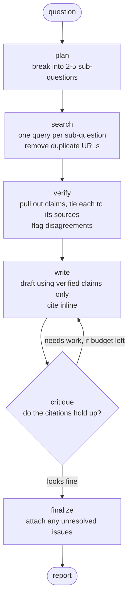

# Autonomous Research Agent

Ask it a research question. It breaks the question into parts, searches the web,
checks every claim against the source it came from, and writes a report where
each factual sentence carries a citation. A second agent reviews the draft and
sends it back if the citations don't hold up.

Built with LangGraph, Tavily and Claude.

Across six test questions, the reports come out at **91.4% correctly-sourced
claims** and **98.7% citation coverage**, scored by an LLM judge whose own
scoring varies by 0.0 points when you run it repeatedly. The critic loop itself
turned out not to improve on that — see [Results](#results).

---

## The problem it solves

Ask any LLM a research question with web search attached and you get a confident,
well-written report. The problem is invisible: some sentences come from the
sources, some come from the model's own memory, and the citations don't reliably
tell you which is which. You can't check it without redoing the research yourself.

This project tries to make that impossible rather than unlikely.

The rule is that a claim has to name the source that backs it up, and that rule
lives in the code, not in a prompt:

```python
class Claim(BaseModel):
    statement: str
    source_urls: list[str] = Field(min_length=1)
```

A claim with no source raises a validation error. It can't be built. The
fact-checking step has nowhere to put an unsourced statement except a separate
"unsupported" list that the writer is told to leave out.

A model can ignore a prompt. It can't ignore a schema.

### Proof that it works

There's a simple test. Run the pipeline with the mock search backend, which
returns realistic-looking sources that contain no real facts, and ask about
detecting model drift — a topic Claude knows well from training.

A normal RAG pipeline writes a confident report from memory and attaches
citations that don't support it. This one extracted **zero claims**, put four
statements in the unsupported list, and wrote a report saying it couldn't report
any findings.

That's the whole idea working under the hardest case: a model that knows the
answer, and sources that don't contain it.

---

## How it works



| Step | What it does |
|---|---|
| `plan` | Splits the question into 2–5 sub-questions, each with a search query |
| `search` | Runs each query, removes duplicate URLs, caps the total number of sources |
| `verify` | Pulls out claims and ties each one to the source URLs that support it. Flags where sources disagree, and lists anything no source backs up |
| `write` | Writes the report using only verified claims, citing sources inline as `[n]` |
| `critique` | Checks the draft against the verification notes. Either accepts it or returns a list of specific problems |
| `finalize` | If the loop never settled, releases the draft the critic liked best, with the remaining problems attached |

I used LangGraph instead of a simple chain because `write → critique → write` is a
loop, and chains can't loop. The number of rewrites is capped. If the budget runs
out while the critic is still unhappy, the report ships with an **Unresolved
Review Issues** section rather than pretending to be clean.

---

## Results

I ran an ablation — same questions, same sources, critic turned on versus off —
to find out whether the critic actually helps.

The metric is **sourced claim rate**: out of every factual sentence in the report,
what fraction is correctly cited. It counts both wrong citations and missing ones
as failures, so you can't score well by simply not citing anything.

Six questions. Search runs once per question and both versions get the exact same
sources, so the critic is the only thing that differs between them.

| | critic off | control, re-run | critic on |
|---|---|---|---|
| sourced claim rate | 91.4% | 91.4% | **90.2%** |
| citation coverage | 98.7% | 98.7% | 98.7% |
| drafts written | 1.00 | 1.00 | 1.33 |

**The critic made things 1.2 points worse**, against a noise floor of 0.0 points.

It only stepped in on 1 question out of 6. On the other 5 it accepted the first
draft, so both versions produced identical reports and scored identically —
exactly 0.0% difference every time. That exactness is useful: it shows the setup
is clean, with no leakage between the two versions.

Full results, down to per-sentence judgments:
[`evals/results/`](evals/results/).

### Why the critic has nothing to do

The first draft is already good. By the time I'd finished fixing the evaluation,
the writer and the verification step together were producing reports at 91.4%
sourced claims and 98.7% coverage. There was almost nothing left to catch.

Here's the control score across runs as I fixed measurement bugs: 76.5% → 82.6% →
91.9% → 91.4%. Every fix improved the **first draft**. The critic had been
covering for weaknesses in the writer's prompt, and those are better fixed in the
writer's prompt.

Put simply: the critic checks that the report's citations match what the
verification step produced. But the verification step already guarantees that by
construction. It's checking a check.

### What the critic does and doesn't do

It does find real problems. There's a test (`tests/test_critic.py`) that hands it
a report with four deliberate errors — a claim from the "unsupported" list used as
fact, a sentence with no citation, a missing disagreement between sources, and a
citation pointing at the wrong source number. It finds all four and describes each
one correctly.

There's a second test with a clean report, because a critic that rejects
everything would pass the first test and be just as useless.

So it works. It just has nothing to do on clean input. It's insurance against a
bad draft, and on this pipeline drafts don't go bad often enough for the insurance
to pay for itself. It costs 33% more drafts.

### The one time it stepped in, it made things worse

On question 1 the critic ran three drafts, raised problems every time, and never
accepted any of them. That report lost **31.5 points**.

The cause: the system was shipping the *last* draft of that chain. But a draft
chain the critic keeps rejecting means the writer is thrashing, not improving. I
changed `finalize` to release whichever draft the critic rated best, using the
critic's own problem counts — information the agent has while running, not the
evaluation's score. That moved question 1 from −31.5 to −7.1, and the overall
result from −5.2% to −1.2%.

That was the single most useful change in the project.

---

## What it took to trust the numbers

This is the part I'd actually want to talk about. The evaluation was wrong four
times before it was right, and each time the wrong version produced a confident
number I would have published.

**1. The metric rewarded not citing things.** My first metric was correct
citations divided by cited sentences. A report scored 100% — by leaving five
factual sentences with no citation at all. Uncited sentences weren't in the
denominator, so the metric couldn't see them. I changed it to correct citations
divided by *all* factual sentences. The measured effect flipped sign.

**2. The two versions weren't getting the same sources.** I cached search results
per query and assumed `temperature=0` made the planner repeatable. The cache hit
rate came back at 22%, which meant the two versions had searched for different
things, so the "effect" included search variation. Fixed by running the planning
and search once per question and giving both versions the identical source list.

**3. My control couldn't detect its own blind spot.** I added a control arm — run
the no-critic version twice, and the difference is noise. It returned exactly 0.0
every time, which looked reassuring. It was running back to back with the first
version on identical input, which is the one situation where two API calls agree
automatically. I moved it to run last, separated by the same amount of work as the
critic version.

**4. The judge's scores swung by 25 points.** This was the big one. I scored one
report ten times and got results ranging over 25 points, with a standard deviation
of 8.2. Worse, the judge couldn't agree on how many sentences the report had —
anywhere from 17 to 20.

The cause was that I'd asked the judge to do three things at once: decide which
pieces of text were factual sentences, copy them out, and score them. The
denominator was something the model made up each time.

The fix was to split the report into sentences in plain Python, hand the judge a
numbered list, and ask for one label per number. After that, ten repeat scorings
of the same report gave **identical results** — both on a clean report (100%) and
a messy one (58.8%).

**Judge variation went from 8.2 points to 0.0.** That's the only reason the −1.2%
result means anything. The earlier numbers I'd measured (+12.1%, +4.9%) were
smaller than the noise in my own scoring.

You can reproduce this: `python scripts/judge_variance.py --n 10`.

---

## Running it

```bash
git clone https://github.com/pujyakothapalli/autonomous-research-agent.git
cd autonomous-research-agent
python3 -m venv .venv && source .venv/bin/activate
pip install langgraph langchain-anthropic tavily-python pydantic python-dotenv pyyaml pytest
```

Create a `.env` file:

```
ANTHROPIC_API_KEY=your_key
TAVILY_API_KEY=your_key

RESEARCH_MODEL=claude-haiku-4-5
MAX_REVISIONS=2
MAX_SOURCES=6
RESULTS_PER_SUBQUESTION=3
JUDGE_REPEATS=1
```

Ask it something:

```bash
python -m research_agent.main "What are the main approaches to detecting model drift?" --print
```

The report lands in `reports/`. Each step prints as it runs.

Without a Tavily key it falls back to mock search so the pipeline still runs end
to end. The output is made up — fine for checking that everything is wired
correctly, useless as research.

### Tests

```bash
pytest tests/
```

`test_critic.py` calls the real API (a few cents) and is skipped if no key is set.

### Evaluation

```bash
python evals/run_eval.py                      # all questions
python evals/run_eval.py --questions q01,q03  # just some
python scripts/judge_variance.py --n 10       # how noisy is the scoring
```

Search results and plans are cached to JSON, so re-running costs no Tavily quota
and gives you the same sources. Results are saved after each question, so a crash
part way through doesn't lose everything.

Cost: a full six-question run is three versions × about five model calls per
question, plus scoring. Cents on Haiku, but it adds up across runs — set a spend
limit in the Anthropic console.

---

## Code layout

```
research_agent/
  state.py      Output schemas and the LangGraph state
  tools.py      Search backends (Tavily / mock) and the model setup
  nodes.py      The six agents and all the prompts
  graph.py      Wiring and the loop
  main.py       Command line entry point
evals/
  judge.py      Sentence splitting and the LLM judge
  cache.py      Search and plan caches
  run_eval.py   The three-version comparison
  questions.yaml
  results/      Committed, so the numbers above can be checked
scripts/
  judge_variance.py   Measures how noisy the scoring is
tests/
```

Four things worth knowing if you're reading the code:

- **State uses reducers.** `sources` and `trace` are marked with `operator.add` so
  they build up across steps. Everything else gets overwritten. Get this wrong and
  the search step quietly wipes out its own earlier results.
- **Search is passed in, not imported.** It's a `Protocol`, which is what lets the
  evaluation give both versions the same sources. Without it the comparison would
  be meaningless.
- **The judge never decides what counts as a sentence.** `extract_sentences()`
  does that in plain code. See the section above for why that matters.
- **`build_graph()` takes `include_critic` and `skip_retrieval` flags.** They exist
  for the evaluation, not for normal use.

---

## What it can't do

**It doesn't weigh source quality.** A vendor blog counts the same as a
peer-reviewed paper. One report cited "91% of ML models degrade over time" to
three sources, all of which were repeating the same unsourced marketing claim.
Three sources repeating one original is really one source, and the system can't
tell. This is the biggest gap.

**The judge is the same model family as the writer**, so it might share the same
blind spots. Every results file records which model did the scoring. Set
`JUDGE_MODEL` to a different, stronger model before trusting a number for
anything serious.

**Six questions is a small sample.** Enough to show the critic's effect isn't
large. Not enough to put a confidence interval on it.

**Verification only sees the text the search API extracts.** Full-page extraction
helps a lot compared to short snippets, but a claim about a number in a table the
extractor missed can't be verified, so it gets dropped — meaning true information
is sometimes lost.

**Disagreement detection is cautious.** Two sources reporting different numbers
might be measuring different things. The prompt under-reports rather than filling
the report with false conflicts.

**One known scoring artifact.** On question 1 the released draft is identical to
the control's, but `finalize` attaches an "Unresolved Review Issues" section. The
judge sees that as context, and one sentence's score changes because of it. It
accounts for most of the remaining −7.1 on that question. Small enough that I left
it alone, but it's there.

### If I kept going

The critic needs a job the verification step isn't already doing. The obvious one:
check that the report actually covers all the sub-questions the planner produced.
Nothing checks that today, and a report can be perfectly cited while quietly
dropping a third of the question. That would also need a new metric, since
citation accuracy can't see coverage.

---

## License

MIT.
